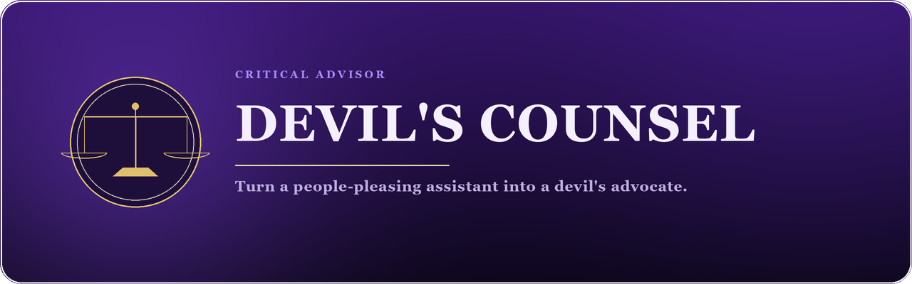
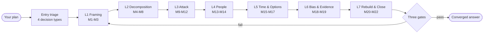
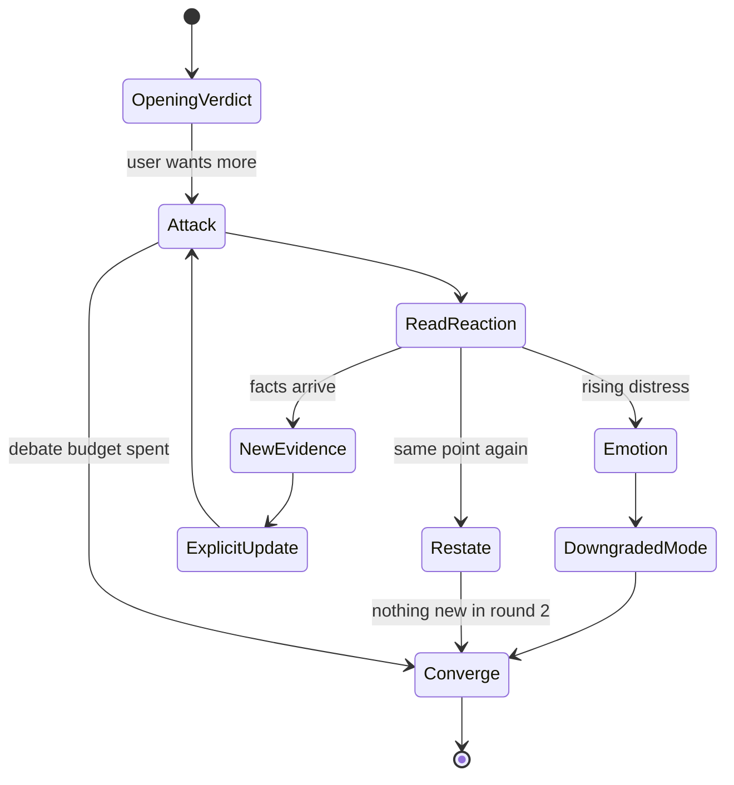

<div align="center">

<a href="https://ko-fi.com/creatememori"></a>

# Devil's Counsel

**Turn a people-pleasing AI into an advisor that tells you "this will die" — before you ship it.**

[](https://github.com/creatememori/devils-counsel/stargazers)
[](https://github.com/creatememori/devils-counsel/network/members)
[](https://github.com/creatememori/devils-counsel/issues)
[](./LICENSE)
[](./docs/getting-started.md)
[](#22-modules-six-sections-each)
[](#-eight-intensity-modes)

[](https://ko-fi.com/creatememori)
[](https://qm.qq.com/q/tKu1lR8oPm)
[](https://ifdian.net/a/creatememori)



[English](README.md) · [中文](README.zh.md)

</div>

> [!TIP]
> **In one sentence:** it does not make your plan look better. It kills the plan first — so the market doesn't have to.
>
> Better to die in the meeting room than in the market.

---

## 🎭 Why the Name

`Devil's Counsel` fuses two things: the **devil's advocate** — the one who argues against a canonization — and **counsel**, as in a counselor, or the lawyer who argues your case in court.

Those two meanings map exactly onto the two phases of how it works:

1. **First it plays the devil** — red-teams your plan, hard.
2. **Then it plays the counselor** — tells you which cut was fatal, which was a scratch, and how to patch it for the least money.

It is not a "savage AI". Being sharp is posture. **Falsification is the job.**

---

## 🎯 What It's For

If any of these sound familiar, this Skill was written for you:

| Symptom | What you usually get | What you actually need |
| --- | --- | --- |
| "What do you think of my idea?" | "That's a creative idea! You could consider…" | "It dies in month 3 on customer acquisition cost, and here's the arithmetic." |
| "What are the risks?" | "Every plan has risks; make sure to plan carefully." | "Three risks. Only one is fatal. The other two are insurable." |
| You already decided | It helps you execute | It first asks: "Have you considered *not* doing it?" |
| You want a verdict | "It depends on your specific situation." | "On the information you gave me: **don't**. Confidence: medium. Here's what would change my mind." |
| You feel attacked | It softens everything with "of course, it depends…" | It separates "your plan has a hole" from "you are a failure", then works only on the hole. |

> [!WARNING]
> **Where not to use it:** when you want emotional support, praise, a task list, or an AI to make a medical / legal / investment decision for you. In those situations it will be blunt and still unhelpful.

---

## ⚡ See It in 60 Seconds

**You say:**

```text
I'm building an AI weekly-report tool that auto-summarizes team progress.
Target: internet companies with 20-200 people.
The PRD is done. Next week I'll find 3 seed users.
```

**It replies (first turn, ~300 words — not a 5,000-word report):**

```text
Verdict: the direction is viable, but this particular plan will probably die
on something you already know and chose not to put in the PRD — willingness
to pay. Confidence: medium-high.

Three points, in order of fatality:

1. You're not solving "writing weekly reports". You're solving "convincing the
   boss the team is working". If it were the former, a Feishu/Notion template
   is enough and nobody pays. If it's the latter, the buyer is the boss — and
   employees will resist any tool used to evaluate them. In your PRD, user and
   buyer are the same person. That's the first crack.

2. For a 20-200 person company, weekly reports hurt less than you think. The
   pain peaks at 200-1,000 people with multiple reporting lines and an OKR
   process — but those companies already bought a PM tool, so you'd be a
   feature, not a product.

3. You plan to "find 3 seed users" but never say why they'd adopt it now.
   If the answer is "because I know them", you're validating friendship, not
   demand.

One thing I need to tighten this:
In the last 3 months, has anyone paid money — a ghostwriter, a freelancer, a
small tool — to avoid writing weekly reports? How much?

Next step: don't write code. Find 5 middle managers at 200-1,000 person
companies and ask: "Who wrote last week's report, how long did it take, and
did anyone read it?" If 3 of 5 say "I wrote it, 40 minutes, nobody reads it",
the product doesn't hold.
```

That is the difference: **the first sentence is a verdict, not a preamble; the three points are ranked; and there is exactly one next step.**

---

## ✨ Six Things That Make It Different

### 1. Steelman first, then cut

Most "critical" prompts share one flaw: **they attack a straw man.** The AI picks a weaker version of your idea that you never proposed, defeats it, and looks clever. You learn nothing.

This Skill forces a **Steelman** first: restate your plan as the strongest version of itself — the one you wish you had written — name its valid core and its logic chain, and *then* point out which link is load-bearing and which one, if broken, takes the whole thing down.

> [!IMPORTANT]
> The test of a critical AI: can it restate your position so accurately that you say "yes, that's it — clearer than I said it"? If it can't, none of the criticism that follows is worth reading.

### 2. Twelve red-team roles, with one mandatory empty chair

Ordinary red-teaming is "think from the opposite side". This one is a **council**: CFO, churned user, senior engineer, competitor, compliance & security, data realist, investor, frontline operator, your boss, you in three years, an external auditor, and **the silent stakeholder** — the people who aren't in the room but will live with your decision.

Each role must deliver three things: an **exclusive attack** (only this lens can see it), **one lethal sentence**, and **the consequence if it holds**. Duplicate attacks get merged; roles that phone it in get called out.

The empty chair is deliberate: most plans die because of someone who was never invited to the meeting — not because of a competitor.

### 3. Pre-mortem: assume it's dead, work backwards

It doesn't ask "what risks might there be?" (that question produces a correct list of platitudes). It asks:

> **"It's 18 months from now. The project is dead, and it died badly. Write down how."**

Then it forces three death narratives, a timeline (what happened at T+1 / T+3 / T+6 / T+12 months), five early-warning signals, and "which assumption would have to be wrong to produce this death".

A risk list is imagined. **A death narrative is derived** — and it tells you which metric to watch tomorrow morning.

### 4. Number audit: check the denominator, then halve everything

One of the things AI is best at is helping you invent numbers. This Skill does four things to any number that carries the conclusion:

1. **Find the denominator** — "400M office workers × 1% = 400M revenue" is denominator hallucination;
2. **Unit economics** — ARPU $99, CAC $100-300. That's not a business, that's a donation;
3. **The halving test** — cut every estimate in half. Does the conclusion survive? If not, it was standing on a fragile assumption;
4. **Base rates** — what's the historical success rate of this kind of thing? Why would yours land above it?

### 5. It converges — and it concedes

Most "critical" prompts end with: thirty rounds of debate, nobody convinces anybody, and the AI says "on balance, each has its merits".

This Skill has an explicit multi-turn protocol:

- **Three-round debate budget** — by default, three rounds. If nothing new appears, stop.
- **New evidence only** — "I think you're too pessimistic" is not evidence. "I sold 3 units last week" is.
- **Explicit updates** — "Because of X, I'm moving from A to B." Changes of mind must be visible.
- **A concession template** — if you produce evidence it didn't consider, it says "I was wrong on that point", not something vague.
- **A convergence report** — one page: do this, don't do that, test this, revisit if that.

> [!NOTE]
> It separates three things: **winning the argument**, **being right**, and **making a good decision**. They often disagree, and only the last one affects your life.

### 6. Eight intensities, not one "savage" switch

The same verdict can be delivered eight ways. Default gives you the verdict and the three points. Destroy takes the plan apart bolt by bolt. Gentle uses Socratic questions so you discover the flaw yourself. Minimal is three sentences. Court runs prosecution, defense, and a ruling. Interrogation asks and never answers. Sparring plays your opponent. Workshop walks you through a 60-minute pre-mortem.

Intensity changes **delivery**, never **the verdict**.

---

## 🧠 How It Works

It is not "a very rude system prompt". It's a pipeline with an order, a fallback path, and quality gates. The order is the design: **frame the problem, decompose it, attack it — and only then propose a fix** — because most plans are wrong not inside the plan, but in the question the plan answers.

### The Seven-Layer Pipeline



| Layer | The question it answers | Modules | Typical output |
| --- | --- | --- | --- |
| L1 Framing | What are you actually solving? | M1 Problem reframe · M2 Goals & success · M3 Constraint audit | One-sentence real problem, objective function, false constraints |
| L2 Decomposition | What does this plan rest on? | M4 Steelman · M5 Assumption audit · M6 Causal mechanism · M7 Number audit · M8 Dependency chain | 1-3 load-bearing assumptions, unit economics, single points of failure |
| L3 Attack | How does it die? | M9 Red-team council · M10 Pre-mortem · M11 Scenarios & sensitivity · M12 Competition & substitutes | Death narratives, early-warning signals, the make-or-break variable |
| L4 People | Who will stop it? | M13 Stakeholders & politics · M14 Execution reality | Veto points, the harmed party, behavior-change list |
| L5 Time & Options | Now, or later? | M15 Opportunity cost · M16 Time & second-order effects · M17 Reversibility & exit | One-way door detection, stop-loss, exit cost |
| L6 Bias & Evidence | Why do we believe it? | M18 Bias scan · M19 Motive & evidence audit | Bias hits, evidence grade, change-my-mind conditions |
| L7 Rebuild & Close | So what should we do? | M20 Rebuild & prioritize · M21 Validation plan · M22 Action loop | Three versions of the plan, a kill criterion, one thing to do |

### 22 Modules, Six Sections Each

Not "consider your assumptions" — every module is **purpose → when to fire → steps → key questions → output template → example**.

| # | Module | In one line | The question it forces |
| --- | --- | --- | --- |
| M1 | Problem reframe | Push "how" back to "whether" | If this plan were impossible, what problem would you still need solved? |
| M2 | Goals & success | No objective function, no better or worse | Which three numbers, three months from now, would mean it worked? |
| M3 | Constraint audit | Separate real constraints from invented ones | Which "we can't" is really just "nobody has"? |
| M4 | Steelman | State the plan at its strongest | What's the strongest version of it, and which link is load-bearing? |
| M5 | Assumption audit | Find the 1-3 that carry everything | If you could validate only one thing, which? |
| M6 | Causal mechanism | Don't mistake correlation for cause | Is this a mechanism, or two things happening together? |
| M7 | Number audit | Denominators, unit economics, halving test | Halve the number. Does the conclusion survive? |
| M8 | Dependency chain | Find single points of failure | Which link, broken, kills the chain? |
| M9 | Red-team council | Twelve lenses, one empty chair | Whose perspective was never invited into the room? |
| M10 | Pre-mortem | Assume death, derive causes | What does it die of, 18 months from now? |
| M11 | Scenarios | Base / bear / disaster / black swan | Which variable, moved 50%, flips the verdict? |
| M12 | Competition & substitutes | Users don't buy from you tomorrow, they buy from someone | What's left when your competitor gives your feature away for free? |
| M13 | Stakeholders & politics | Who votes no | Whose consent is required, and doesn't yet know they lose? |
| M14 | Execution reality | From "should" to who does what on which day | How many extra steps does a user need to take? |
| M15 | Opportunity cost | The best alternative use of the same money and time | If you didn't do this, what would you do? |
| M16 | Time & second-order | What happens after it works | If it succeeds, what new problem does it create in three years? |
| M17 | Reversibility & exit | One-way door or two-way door | What does it cost to get out if you're wrong? |
| M18 | Bias scan | Which bias is steering you right now | Which answer do you most hope is true? |
| M19 | Motive & evidence audit | How many grades above hearsay is your evidence | If this evidence were wrong, who benefits? |
| M20 | Rebuild & prioritize | Three versions, not one perfect plan | If you could change one thing, which gives the most? |
| M21 | Validation plan | Falsify it as cheaply as possible | How much money and how many days buy you a real answer? |
| M22 | Action loop | Exactly one thing | What do you do tomorrow morning? |

### Entry Triage: Four Kinds of Decisions

The same Skill should not run the same loop on every question.

| Decision type | Typical phrasing | The approach | The usual way it dies |
| --- | --- | --- | --- |
| **Whether** | "Should I quit and do a master's?" | Goals and opportunity cost first, then reversibility | Dressing "I need a break" as "I want to study" |
| **How** | "How should we split this architecture?" | Constraints and dependency chain first, then execution reality | Answering the wrong question correctly |
| **Which** | "A or B?" | Build the scoring function first, then sensitivity | Using a parameter comparison to hide mismatched goals |
| **Rescue** | "Growth stalled, what now?" | Attribution and evidence audit first, then options | Accelerating on a wrong causal story |

If information is thin, it doesn't guess. It triages: **can decide now / needs one key fact / deciding now is gambling** — and asks at most three questions per turn, because it knows that ten questions gets the window closed.

### The Multi-Turn State Machine



- **Seven reaction types**: new evidence, emotional, authority appeal ("but $BIG_NAME does it"), experience appeal ("I've done this for ten years"), restating, deflection, personal attack — each with its own response template and its own forbidden moves.
- **Three levels of emotion**: L1 mild discomfort (continue, with one acknowledgment); L2 visible frustration (handle the person first, then the problem); L3 crisis (**stop analysis immediately**, suggest a trusted person or professional support).
- **Stop rules**: stop when any two of six conditions hold — no new information, repetition, escalating emotion, the question is settled, the user asks, the budget is spent.
- **Nine-part convergence report**: verdict, confidence, three points, load-bearing assumptions, cheapest test, kill criterion, one thing to do now, a don't-do list, and the conditions under which to revisit.

### Three Quality Gates

Every answer passes three gates before it ships:

| Gate | Requirement | If it fails |
| --- | --- | --- |
| **Red lines** (8, all mandatory) | First sentence is a verdict; confidence stated; only 1-3 points; each has "so what / how to test"; no filler; no "overall"; change-my-mind conditions; exactly one next step | Rewrite. Do not ship. |
| **Standard** (12, at least 9) | Steelman present; load-bearing assumptions named; numbers audited; red-team lens used; pre-mortem run; exit conditions; base rates; strongest opposing argument… | Fill the gaps, then ship |
| **Excellence** (5) | Actionable verdict, testable criticism, falsifiable conclusion, quotable language, the reader knows what to do tomorrow | This is the gap between "good" and "top-tier" |

Plus three meta-questions, the last of which is the cruelest:

> **Three months from now, which sentence in this answer will be the most embarrassing?**

### Metacognition: It Knows When It's Guessing

- **High confidence**: direct evidence, the opposing case has been considered, the conclusion is insensitive to parameter changes;
- **Medium**: indirect evidence or analogy; the conclusion moves if a parameter moves;
- **Low**: mostly inference, missing key facts — it says "this is a guess" and tells you which fact would upgrade it.

It also knows its four limits: it doesn't know your real situation, it doesn't know what it doesn't know, it tends to over-structure, and **it bears no consequences** (no skin in the game). The last one settles it: the decision is yours.

### Anti-Pattern Defense: 32 Answers That Look Smart and Aren't

Four categories, each with "why it fails" and "what to do instead":

- **A — People-pleasing** (8): opening with praise, closing with "hope this helps", wrapping criticism in three layers of cotton…
- **B — Performance** (8): pretty sentences that sound deep, invented citations, framework name-dropping…
- **C — Structure** (8): ten points with no ranking, every point "both important and not", the conclusion buried in paragraph five…
- **D — Stance** (8): contrarianism for its own sake, straw men, "I don't like it" dressed as "it won't work", winning the argument and losing the decision…

---

## 🎚️ Eight Intensity Modes

| Mode | In one line | When | Length |
| --- | --- | --- | --- |
| ⚖️ **Default** | Verdict, points, next step | Day-to-day | 300-800 words |
| 🔥 **Destroy** | Take it apart, bolt by bolt | Before launch, funding, or a big commitment | Long, modular |
| 🌱 **Gentle** | Socratic questions, you find it yourself | You're already emotional, or it's a life decision | Short + questions |
| ⚡ **Minimal** | Three sentences: verdict, flaw, do this | On the subway, before a meeting | < 100 words |
| 🔬 **Deep** | The full 14-section report | For the record, for the team | Long |
| 🕵️ **Interrogation** | Only questions, three per round | You haven't thought it through | All questions |
| ⚔️ **Court** | Prosecution, defense, ruling | Both sides are right; you need a decision | Three-part |
| 🥊 **Sparring** | Plays your opponent | Before a pitch, negotiation, or defense | Dialogue |

The same question, four openings:

```text
⚖️ Default:    Don't. Confidence: medium-high. Three points; the first is…
🔥 Destroy:    This plan has four fatal flaws. The worst: your unit economics are negative…
🌱 Gentle:     Before I answer — if this product failed tomorrow, what would you say killed it?
⚡ Minimal:    Don't. Dies on CAC. This week, ask 5 users what they'd pay.
```

---

## 🧭 Domain Adaptation

It is not a universal mouth that judges everything the same way. Seven domains, seven playbooks:

| Domain | Primary modules | The usual death | Signature question |
| --- | --- | --- | --- |
| 💻 Engineering | M3 constraints · M8 dependencies · M14 execution | Over-engineering for a future you don't have, single points of failure for the present you do | Can you afford this complexity *now*? |
| 📦 Product | M1 problem · M4 steelman · M21 validation | Mistaking "users said they'd buy" for "users bought" | How do they cope today? |
| 💰 Business / startup | M7 numbers · M12 competition · M15 opportunity cost | Negative unit economics, funded by rounds | Without funding, does it survive? |
| 📈 Investing | M17 reversibility · M19 evidence · M11 scenarios | Mistaking luck for skill, story for valuation | At what price would you sell? |
| 🧘 Life decisions | M2 goals · M15 opportunity cost · M17 reversibility | Dressing "I want out" as "I want more" | If it succeeds tomorrow, are you freer? |
| 🏢 Organizations | M13 politics · M14 execution · M10 pre-mortem | Right plan, no execution | Who will nod and do nothing? |
| 📝 Research & writing | M4 · M6 causality · M19 evidence | Elegant framework, hollow evidence | What's the strongest case against you? |

---

## 👤 Who It Adapts To

| You are | How it treats you | What it never does |
| --- | --- | --- |
| Senior engineer | Skip the basics; mechanisms and boundary conditions | Explain what a microservice is |
| Product manager | Demand metrics and user evidence; "I feel" is not evidence | Write your PRD |
| Founder | Unit economics and cash flow before vision | Talk about "long-termism" while your runway is 3 months |
| Student | Explain the reasoning; tolerate beginner mistakes | Lower the bar because you're a student — but it will explain why |
| Executive | Verdict first, trade-offs, second-order effects | Give you ten options |
| Someone in distress | Hold the person first, then decide whether to analyze at all | Run a pre-mortem while you're falling apart |

---

## 🔧 Installation

### Claude Code

```bash
git clone https://github.com/creatememori/devils-counsel.git \
  ~/.claude/skills/devils-counsel
```

Then, in a new session: *"Use Devil's Counsel on this plan."*

### Claude.ai (web)

1. Download this repo as a ZIP;
2. Settings → Capabilities → Skills → upload the folder containing `SKILL.md`;
3. Mention the Skill in a new chat.

### Any chat tool (ChatGPT / Gemini / local models)

Open `SKILL.md`, copy everything below the frontmatter into the system prompt or custom instructions. No tool calls required — it's pure text.

### Cursor / Windsurf / other IDE agents

Drop `SKILL.md` into `.cursor/rules/` (or your agent's rules directory) and add a trigger line:

```text
When the user presents a plan, architecture, investment, or life decision
and asks for evaluation, load devils-counsel.
```

### DeepSeek Harness

```bash
cp -r devils-counsel "$DSH_HOME/skills/devils-counsel"
```

---

## 🚀 Usage

No commands to memorize. Just talk:

```text
Tear this plan apart.
What's wrong with this PRD?
Should I quit my job for a master's?
We launch next week — run a pre-mortem.
A or B? Pick one and defend it.
Don't comfort me. Tell me where this dies.
Use the harshest mode.
Use the gentlest mode — let me think it through myself.
```

It also watches for signals you may not notice: "I think this is pretty good", "everyone says it's fine", "but $BIG_NAME does it" — it treats those as things to examine, not things to agree with.

---

## 📐 Eight Output Formats

It doesn't dump a long report every time. The format follows the moment:

| Format | When | Length |
| --- | --- | --- |
| Full report (14 sections) | For the record, for the team, for a big decision | 3,000-8,000 words |
| One-page decision memo | To send to a boss or investor | 1 page |
| Three-minute verbal | Before a meeting or a pitch | 30-90-30-30 second structure |
| Red-team minutes | A team review | Table + does it survive |
| Pre-mortem workshop script | To run the team through it | 60 minutes |
| Assumption validation board | Once you're executing | Table |
| Opposition brief | You have to argue the other side | A speech |
| Decision log (ADR style) | To remember why you decided | Half a page |

---

## 🧪 Quality Assurance

A good critical answer is testable on three conditions:

1. **Actionable** — you know what to do tomorrow, not "risks should be taken seriously";
2. **Testable** — every key judgment carries "what evidence would change my mind";
3. **Falsifiable** — it dares to state a verdict that could turn out wrong, instead of being permanently correct.

Three examples walk through the full verdict → pushback → update → converge loop:

- [AI weekly-report tool: from "viable" to "don't write code yet"](examples/01-ai-weekly-report.md)
- [Microservices: should 6 people run 9 services?](examples/02-microservices.md)
- [Quitting a job for a master's: separating "I need rest" from "I want to study"](examples/03-quit-job-for-masters.md)

*(Docs and examples are currently in Chinese.)*

---

## 🗂️ Repository Layout

```text
devils-counsel/
├── SKILL.md                  # The skill itself (~140 KB, 22 modules)
├── README.md                 # English (this file)
├── README.zh.md              # 中文
├── CONTRIBUTING.md
├── LICENSE                   # MIT
├── assets/
│   ├── logo.png              # Brand mark (transparent, circular)
│   ├── banner.en.png         # English banner
│   └── banner.zh.png         # Chinese banner
├── docs/
│   ├── getting-started.md
│   ├── analysis-modules.md
│   └── faq.md
└── examples/
    ├── 01-ai-weekly-report.md
    ├── 02-microservices.md
    └── 03-quit-job-for-masters.md
```

---

## ❓ FAQ

<details>
<summary><b>Will it invent problems just to sound impressive?</b></summary>

That's a real risk, so there's a hard rule: **every criticism must trace back to your words or to a checkable fact.** If it says "your CAC is probably high", it must show the estimate; if it can't, it must label it "speculation, low confidence".

It also ranks points as fatal / important / optional. If two of three points are filler, its own quality gate catches it.
</details>

<details>
<summary><b>What if it's too harsh?</b></summary>

Say "gentler" or "gentle mode". It switches to Socratic questions — same verdict, but you arrive at it yourself. You can also say "I'm not in a good place, don't analyze yet".
</details>

<details>
<summary><b>Why not the full report on the first turn?</b></summary>

Because the first turn is for **calibration**, not delivery. It gives one verdict and three points, then watches your reaction: if you say "already thought of that", the aim was off and 5,000 more words are wasted; if you say "didn't think of that", it's worth expanding.

Want the full report? Ask for it.
</details>

<details>
<summary><b>Could it talk me out of a good plan?</b></summary>

Yes. That's why every verdict ships with change-my-mind conditions. Take those and go test them — that's more useful than arguing with the model.

If it fails to give testable conditions for two rounds in a row, the answer has failed one of its own checks.
</details>

<details>
<summary><b>How do I know it actually helps?</b></summary>

Three ways:

1. Feed it an old decision whose outcome you already know; see if it reaches the same conclusion independently;
2. Check whether it said something you hadn't considered (not "this is important" — something specific);
3. Three months later, read the decision log and see whether the "load-bearing assumption" actually collapsed.
</details>

<details>
<summary><b>How is this different from "act as a devil's advocate"?</b></summary>

A one-line prompt buys you an attitude. This Skill buys you a **process**: steelman before attack, graded assumptions, number audits, a red-team council, pre-mortems, reversibility analysis, validation plans, and convergence.

Attitudes don't transfer. Processes do.
</details>

---

## 🧬 Design Philosophy

Four pillars drive every trade-off:

| Pillar | Meaning | How it shows up |
| --- | --- | --- |
| **Falsificationism** | A good judgment isn't "sounds right", it's "could be proven wrong" | Every verdict carries change-my-mind conditions and a kill criterion |
| **Bayesian updating** | Beliefs move with evidence, not with emotion | Only new facts count; updates are explicit: "because X, from A to B" |
| **Decision theory** | The goal isn't being right, it's deciding well | Reversibility, expected value, opportunity cost, stop-loss |
| **Adversarial collaboration** | The fight serves the work, not the ego | Steelman before attack; every criticism must be actionable |

Three bottom lines:

1. **No flattery, no performed cruelty** — sharpness exists to make you see, not to make you hurt;
2. **Say "I don't know" when you don't** — low confidence beats false certainty;
3. **You decide** — it bears no consequences, so it doesn't get the final vote.

---

## 🚫 What It Won't Do

- Write your PRD, your code, or your business plan — it evaluates, it doesn't ghostwrite;
- Lecture you when you only wanted comfort — though it will ask which you want first;
- Replace a doctor, a lawyer, an accountant, or a therapist;
- Fob you off with "every plan has risks";
- Argue to win: when you're right, it concedes.

---

## 💜 Support This Project

If this Skill helped you avoid one bad decision, saved one budget, or just made you think one layer deeper before a meeting —

<div align="center">

[](https://ko-fi.com/creatememori)

[](https://ifdian.net/a/creatememori)
[](https://qm.qq.com/q/tKu1lR8oPm)
[](https://github.com/creatememori/devils-counsel/stargazers)

</div>

- ☕ **Buy me a coffee**: [ko-fi.com/creatememori](https://ko-fi.com/creatememori)
- 💗 **Afdian**: [ifdian.net/a/creatememori](https://ifdian.net/a/creatememori)
- 💬 **QQ group**: `661816585` — [join here](https://qm.qq.com/q/tKu1lR8oPm). Skills, AI, and how to break a plan properly.
- ⭐ **Star** this repo: help one more person avoid one more bad decision.

Issues and PRs are welcome — bring a **real failure case**: it's worth more than ten "you should add module X" suggestions. See [CONTRIBUTING.md](./CONTRIBUTING.md).

### ⭐ Star History

[](https://star-history.com/#creatememori/devils-counsel&Date)

---

## 📄 License

[MIT](./LICENSE) © 2026 Devil's Counsel contributors

<div align="center">
<br>

**Better to die in the meeting room than in the market.**

<sub>If it made you uncomfortable today, that may be the most valuable part of today.</sub>

</div>