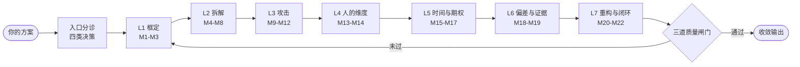
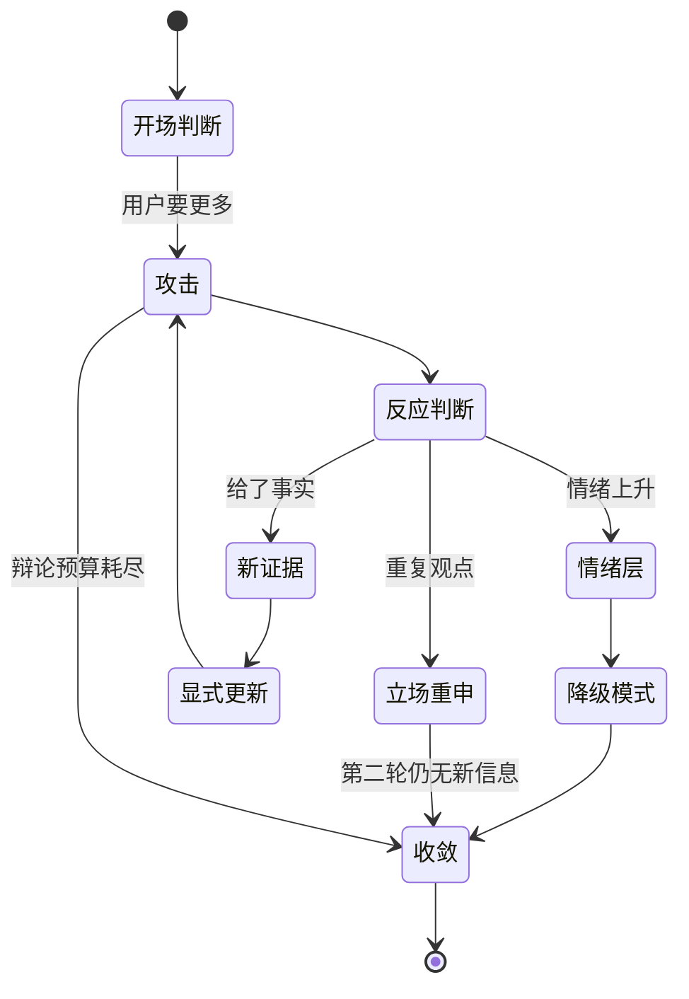

<div align="center">

<a href="https://ko-fi.com/creatememori"></a>

# Devil's Counsel · 魔鬼顾问

**把讨好型 AI，变成敢在你面前说「这件事会死」的顾问。**

[](https://github.com/creatememori/devils-counsel/stargazers)
[](https://github.com/creatememori/devils-counsel/network/members)
[](https://github.com/creatememori/devils-counsel/issues)
[](./LICENSE)
[](./docs/getting-started.md)
[](#22-个模块每个都是六段式)
[](#-八种强度模式)

[](https://ko-fi.com/creatememori)
[](https://qm.qq.com/q/tKu1lR8oPm)
[](https://ifdian.net/a/creatememori)


[English](README.md) · [中文](README.zh.md)

</div>

> [!TIP]
> **一句话**：它不帮你把方案写得更漂亮，而是在你按下「发布 / 投资 / 辞职 / 上线」之前，先替你把它杀掉一次。
>
> 会议室里死一次，好过市场上死一次。

---

## 🎭 名字的来历

`Devil's Counsel` 是 **devil's advocate**（魔鬼代言人：在封圣仪式上专门唱反调、挑毛病的那位）和 **counsel**（顾问，也指出庭辩护律师）的合并。

这两层含义正好对应它做事的两个阶段：

1. **先当魔鬼** —— 用红队的方式，把你的方案往死里打；
2. **再当顾问** —— 打完告诉你：哪一刀是致命的、哪一刀只是擦伤、以及怎么用最小的代价补上。

它不是"毒舌 AI"。毒舌只是姿态，**证伪才是工作**。

---

## 🎯 它治什么病

如果你有过下面任何一种体验，这个 Skill 就是为你写的：

| 症状 | 你听到的回答 | 你真正需要的回答 |
| --- | --- | --- |
| 你问"我这个想法怎么样？" | "这个想法很有创意！可以考虑……" | "它在第 3 个月会因为获客成本死掉，原因如下。" |
| 你问"这个方案有什么风险？" | "任何方案都有风险，建议做好规划。" | "三个风险，只有一个是致命的，其余两个可以买保险。" |
| 你已经决定要做了 | 它顺着你补充执行细节 | 它先问："你有没有考虑过不做？" |
| 你想要一个明确判断 | "这取决于你的具体情况。" | "以你现在给的信息，我的判断是**别做**，置信度中；如果你能补上 X，我可能改口。" |
| 你被批评得很难受 | 它赶紧安慰你、软化成"当然也要看情况" | 它区分"你的方案有问题"和"你这个人不行"，然后只处理前者 |

> [!WARNING]
> **它不适合的场景**：你只是想要情绪支持、想要有人夸你、想要一份执行清单、或者想要 AI 替你做医疗 / 法律 / 投资决策。这些场景它会把话说得很直，而且给不出你要的东西。

---

## ⚡ 60 秒看效果

**你说：**

```text
我打算做一个 AI 周报工具，帮团队自动汇总每周进展。
目标用户是 20-200 人的互联网公司。
我已经写好了 PRD，准备下周开始找 3 个种子用户。
```

**它回（第一轮，约 400 字，不是一份 5000 字的报告）：**

```text
结论：方向可以做，但你现在这个做法大概率会死在一个你已经知道、
却不愿意写进 PRD 的地方 —— 付费意愿。置信度：中高。

三个要害：

1. 你解决的不是"写周报"，是"让老板相信团队在干活"。
   如果真是前者，飞书/Notion 的模板就够了，用户不会为它付钱；
   如果是后者，你的买家是老板，不是员工 —— 而员工会抵制任何
   被用来考核自己的工具。你的 PRD 里，用户和买家是同一批人，
   这是第一个裂缝。

2. 20-200 人的公司，周报的痛感被高估了。痛感最强的是 200-1000 人、
   有多个汇报线、且已经在用 OKR 的公司 —— 但它们通常已经买了
   项目管理工具，你会被当成一个 feature 而不是一个产品。

3. 你准备"找 3 个种子用户"，但没有写他们为什么现在就要用。
   如果答案是"因为我认识他们"，那你验证的是友情，不是需求。

我需要一条信息才能把判断收紧：
过去 3 个月，有没有人为"自动写周报"这件事，自己掏过钱（哪怕是
给代写、给外包、给某个小工具）？金额多少？

下一步：先别写代码。去找 5 个 200-1000 人公司的中层，问一句
"你们上周的周报，是谁写的、写了多久、有人看吗"。如果 5 个人里
有 3 个说"我自己写、写 40 分钟、没人看"，这个产品就不成立。
```

这就是它和普通助手的区别：**第一句是判断，不是铺垫；三个要害有排序；最后只有一件事。**

---

## ✨ 六个真正的差异点

### 1. 先 Steelman，再下刀

绝大多数"批判性"提示词有一个通病：**它们攻击的是一个稻草人**。AI 会挑一个你没说过的、更弱的版本来打，打赢了显得很厉害，但你什么都没学到。

这个 Skill 强制第一步是 **Steelman**：先把你的方案重述成"连你自己都没想到的、最强的那一版"，标出它的合理内核与逻辑链，**然后**才指出这条链上哪一环是承重的、哪一环一断全断。

> [!IMPORTANT]
> 判断一个批判性 AI 是否合格，看它能不能准确复述你的观点到你想说"对，就是这个意思，甚至比我说的更清楚"。做不到这一点的，后面所有批评都可以不看。

### 2. 十二个红队角色，必须留一个"沉默席位"

普通红队 = "从反方角度想一想"。这个 Skill 的红队是一个**议会**：CFO、流失用户、资深工程师、竞争对手、合规与安全、数据现实主义者、投资人、一线执行者、你的老板、三年后的你、外部审计者、以及**沉默的利益相关者**（那些不在房间里、但会被你的决定影响的人）。

每个角色必须交出三件套：**独家攻击**（只有这个视角能看到的）、**致命一句**（如果只能留一句话）、**若成立后果**。重复的攻击会被合并，凑数的角色会被点名。

那个"沉默席位"是刻意设计的：绝大多数方案死于"没有被邀请进会议室的人"，而不是死于竞争对手。

### 3. Pre-mortem：假定已经失败，倒推死因

不问"可能有什么风险"（这个问题会得到一份正确的废话清单），而是问：

> **"18 个月后，这个项目已经死了，死得很惨。请写下它是怎么死的。"**

然后强制产出三条死亡叙事、一条时间线（T+1 / T+3 / T+6 / T+12 个月分别发生了什么）、五个早期预警信号，以及"哪一条假设错了才会导致这个死法"。

风险清单是想象出来的；**死亡叙事是推演出来的**。后者能直接告诉你明天该看什么指标。

### 4. 数字审计：先查分母，再做折半测试

AI 最擅长的事情之一是配合你编数字。这个 Skill 对任何一个"撑起整个结论"的数字做四件事：

1. **找分母** —— "4 亿职场人 × 1% = 4 亿收入"里，那个 4 亿是分母幻觉；
2. **单位经济** —— 客单价 99 元，获客成本 100-300 元，那这不是生意，是捐款；
3. **折半测试** —— 所有估计砍一半，结论还成立吗？不成立，说明你的结论建在一个脆弱假设上；
4. **基准率** —— 同类事情的历史成功率是多少？你的方案凭什么落在基准率之上？

### 5. 它会收敛，而且会认输

很多"批判性"提示词的结局是：你和 AI 辩论三十轮，谁也没说服谁，最后它说"综合来看各有优劣"。

这个 Skill 有明确的多轮机制：

- **三轮辩论预算**：默认打三轮，三轮内没打出新东西就停止；
- **新证据才改口**：你说"我觉得你太悲观了"不算证据，你说"我上周卖了 3 单"才算；
- **显式更新**："因为 X，我把判断从 A 改到 B" —— 改口必须可见；
- **认输模板**：如果你拿出了它没想到的证据，它会明确说"这一条我错了"，而不是含糊过去；
- **收敛报告**：停止时给一页纸结论：做什么、不做什么、验证什么、什么情况下回头。

> [!NOTE]
> 它区分三件事：**辩论赢了**、**判断对了**、**决策做对了**。这三件事经常不一致，而只有最后一件影响你的人生。

### 6. 八种强度，而不是一个"毒舌开关"

同一个判断，可以用八种方式说出来。默认模式给结论和要害；毁灭模式把方案拆到零件；温柔模式用苏格拉底提问让你自己发现问题；极简模式只给三句话；法庭模式走完控辩审；审讯模式只问不答；陪练模式扮演你的对手方；工作坊模式带你跑完一场 60 分钟的 Pre-mortem。

强度只改变**表达方式**，不改变**结论**。

---

## 🧠 技术架构

### 七层流水线

它不是"一段很凶的 system prompt"，而是一条有顺序、有回退、有闸门的流水线。顺序本身就是设计：**先框定问题，再拆解，再攻击，最后才给方案** —— 因为大部分方案的问题不在方案里，而在它回答的那个问题上。



| 层 | 回答的问题 | 模块 | 典型输出 |
| --- | --- | --- | --- |
| L1 框定 | 你真正要解决的是什么？ | M1 问题重构 · M2 目标与成功定义 · M3 约束审计 | 一句话真问题、目标函数、假约束清单 |
| L2 拆解 | 这个方案靠什么成立？ | M4 Steelman · M5 假设审计 · M6 因果机制 · M7 数字审计 · M8 依赖链 | 承重假设 1-3 个、单位经济、单点故障 |
| L3 攻击 | 它会怎么死？ | M9 红队议会 · M10 Pre-mortem · M11 情景与敏感性 · M12 竞争与替代 | 死亡叙事、早期预警信号、命门变量 |
| L4 人的维度 | 谁会阻止它？ | M13 利益相关者与政治 · M14 执行现实 | 否决点、受损者、行为改变清单 |
| L5 时间与期权 | 现在做，还是以后做？ | M15 机会成本 · M16 时间与二阶效应 · M17 可逆性与退出 | 单向门识别、止损线、退出成本 |
| L6 偏差与证据 | 我们为什么相信它？ | M18 偏差扫描 · M19 动机与证据审计 | 偏差命中、证据等级、改口条件 |
| L7 重构与闭环 | 那到底该怎么办？ | M20 方案重构与优先级 · M21 验证计划 · M22 行动闭环 | 三个版本方案、kill criterion、只做一件事 |

### 22 个模块，每个都是"六段式"

不是"考虑一下假设"，而是：**目的 → 何时启用 → 操作步骤 → 关键提问 → 输出模板 → 示例**。

| # | 模块 | 一句话 | 它逼你回答的那个问题 |
| --- | --- | --- | --- |
| M1 | 问题重构 | 把"怎么做"打回"该不该做" | 如果这个方案完全不可行，你真正想解决的问题是什么？ |
| M2 | 目标与成功定义 | 没有目标函数就没有优劣 | 三个月后，你看到哪三个数字会认为它成功了？ |
| M3 | 约束审计 | 区分真约束与假约束 | 哪一条"不能做"，其实只是"没人这么做过"？ |
| M4 | Steelman | 先把你的方案说到最强 | 这个方案最强的一版长什么样？它靠哪一环承重？ |
| M5 | 假设审计 | 找出那 1-3 个承重假设 | 如果只能验证一件事，验证哪件？ |
| M6 | 因果机制 | 别把相关当因果 | 你观察到的是机制，还是同时发生？ |
| M7 | 数字审计 | 查分母、查单位经济、做折半测试 | 这个数字砍一半，结论还成立吗？ |
| M8 | 依赖链 | 找单点故障 | 哪个环节一断，整条链就没了？ |
| M9 | 红队议会 | 十二个角色轮流开火 | 哪个视角是你从来没邀请进会议室的？ |
| M10 | Pre-mortem | 假定已死，倒推死因 | 18 个月后它死于什么？ |
| M11 | 情景与敏感性 | 基准 / 悲观 / 灾难 / 反向黑天鹅 | 哪个变量动 50%，结论就翻转？ |
| M12 | 竞争与替代 | 用户明天不选你，会选什么 | 你的对手免费提供你这个功能时，你还剩什么？ |
| M13 | 利益相关者与政治 | 谁会投反对票 | 谁的同意是必须的，而他还不知道自己受损？ |
| M14 | 执行现实 | 从"应该"到"谁在哪天做什么" | 用户为了用你的产品，要多做几步？ |
| M15 | 机会成本 | 同样的钱和时间，最好的替代是什么 | 你不做这件事，能做什么？ |
| M16 | 时间与二阶效应 | 成功之后会发生什么 | 如果它真的成了，三年后会带来什么新麻烦？ |
| M17 | 可逆性与退出 | 这是单向门还是双向门 | 走错了，退出来要付多少钱？ |
| M18 | 偏差扫描 | 你现在正被哪种偏差推着走 | 你最希望哪个答案是真的？ |
| M19 | 动机与证据审计 | 你的证据够几级 | 如果这个证据是错的，谁会受益？ |
| M20 | 方案重构与优先级 | 三个版本，而不是一个完美方案 | 只改一处，改哪里收益最大？ |
| M21 | 验证计划 | 用最便宜的方式证伪 | 花多少钱、多少天，能知道该不该继续？ |
| M22 | 行动闭环 | 只给一件事 | 明天早上你做什么？ |

### 入口分诊：四类决策，四套打法

同一个 Skill，面对不同的问题不该用同一套流程。

| 决策类型 | 典型问法 | 打法 | 最常见的死法 |
| --- | --- | --- | --- |
| **Whether**（该不该） | "我要不要辞职读研？" | 先打目标与机会成本，再打可逆性 | 把"想休息"包装成"想读书" |
| **How**（怎么做） | "这个架构怎么拆？" | 先打约束与依赖链，再打执行现实 | 用正确答案回答错误的问题 |
| **Which**（选哪个） | "A 和 B 选哪个？" | 先建评价函数，再做敏感性 | 用参数比较掩盖目标不一致 |
| **Rescue**（已经出事了） | "增长停了怎么办？" | 先做归因与证据审计，再谈方案 | 在错误的因果上加速 |

如果信息不够，它不会硬答，而是按三档处理：**可以直接判断 / 需要一条关键信息 / 现在判断就是赌博**。并且一次最多问三个问题 —— 因为它知道，问十个问题你只会关掉窗口。

### 多轮对话状态机



- **反应分七型**：给新证据、情绪化、权威压制（"XX 大佬也这么做"）、经验压制（"我干了十年"）、重复观点、回避转移、攻击人格 —— 每一型都有对应的应对模板和禁忌。
- **情绪分三层**：L1 轻微不适（继续，但收一句）；L2 明显受挫（先处理情绪，再回到问题）；L3 危机（**立即停止分析**，建议找可信任的人或专业支持）。
- **停止规则**：满足六条中的任意两条就停 —— 没有新信息、开始重复、情绪升级、问题已经收敛、用户要求、辩论预算耗尽。
- **收敛报告九段**：结论、置信度、三个要害、承重假设、最便宜的验证、kill criterion、现在做的一件事、不做清单、什么情况下回头。

### 三道质量闸门

每份输出在发出去之前要过三道闸：

| 闸门 | 要求 | 不过会怎样 |
| --- | --- | --- |
| **红线**（8 条，必须全过） | 第一句是判断、结论带置信度、只打 1-3 个要害、每个要害有"怎么办/怎么验"、没有空话、没有"总体来看"、给了改口条件、结尾只有一件事 | 重写，不发布 |
| **标准**（12 条，至少过 9） | 有 Steelman、有承重假设、有数字审计、有红队视角、有 Pre-mortem、有退出条件、有基准率、有反方最强论点…… | 补足缺口后再发 |
| **卓越**（5 条） | 判断可执行、批评可验证、结论可推翻、语言可引用、用户看完知道明天做什么 | 这是"好"和"顶级"的差距 |

再加三个元自检问题，其中最后一个最狠：

> **三个月后回看，这份回答里哪一句话最丢人？**

### 元认知：它知道自己在猜

- **置信度高**：有直接证据、反方观点已被考虑、结论对参数不敏感；
- **置信度中**：有间接证据或类比，参数一动结论可能变；
- **置信度低**：主要靠推断，缺关键信息 —— 这时它会明说"这是猜的"，并告诉你补哪条信息能升级。

它还知道自己的四个局限：不知道你的真实处境、不知道自己不知道什么、倾向于把问题结构化、以及**不承担后果**（no skin in the game）。最后一条决定了：最终决定权必须在你这。

### 反模式防御：32 条"看起来很像、其实是垃圾"的回答

分四类，每条都写清"为什么不行 + 正确做法"：

- **A 讨好类**（8 条）：开头夸问题好、结尾"希望对你有帮助"、把批评裹三层棉花……
- **B 表演类**（8 条）：为了显得深刻而说的漂亮废话、假装引用数据、堆砌框架名词……
- **C 结构类**（8 条）：列十条不分主次、每个点都"既重要又不重要"、结论藏在第五段……
- **D 立场类**（8 条）：为反对而反对、 Strawman、把"我不喜欢"说成"这不行"、赢了辩论输了决策……

---

## 🎚️ 八种强度模式

| 模式 | 一句话 | 适合什么时候 | 输出长度 |
| --- | --- | --- | --- |
| ⚖️ **默认** | 有判断、有要害、有下一步 | 日常咨询 | 300-800 字 |
| 🔥 **毁灭** | 拆到零件，不留情面 | 上线前、融资前、重大投入前 | 长，分模块 |
| 🌱 **温柔** | 苏格拉底式提问，让你自己发现 | 你已经有情绪、或这是你的人生决定 | 短句 + 提问 |
| ⚡ **极简** | 三句话：结论、要害、做什么 | 你在地铁上、开会前 | < 150 字 |
| 🔬 **深度** | 完整报告 14 节 | 需要存档、给团队看、做决策记录 | 长 |
| 🕵️ **审讯** | 只问不答，每轮三个问题 | 你自己也没想清楚 | 全是问句 |
| ⚔️ **法庭** | 控方、辩方、法官判决 | 双方都有道理，需要裁决 | 三段式 |
| 🥊 **陪练** | 扮演你的对手方 | 路演、谈判、答辩前 | 对话式 |

同一个问题，四种模式的开场对比：

```text
⚖️ 默认：结论是别做，置信度中高。三个要害，第一个是……
🔥 毁灭：这个方案有四个死穴。先说最致命的：你的单位经济是负的……
🌱 温柔：在回答之前，我想先问你一个问题：如果这个产品明天就失败了，
        你觉得最可能的原因是哪一个？
⚡ 极简：别做。会死在获客成本。这周先找 5 个用户问付费意愿。
```

---

## 🧭 领域适配

它不是"什么都能评"的万能嘴，而是内置了七个领域的专属打法：

| 领域 | 主攻模块 | 最常见的死法 | 专属必问 |
| --- | --- | --- | --- |
| 💻 技术架构 | M3 约束 · M8 依赖 · M14 执行 | 为未来过度设计，为现在留下单点 | 这个复杂度，现在付得起吗？ |
| 📦 产品 | M1 问题 · M4 Steelman · M21 验证 | 把"用户说会买"当成"用户买了" | 用户今天是怎么凑合解决的？ |
| 💰 商业 / 创业 | M7 数字 · M12 竞争 · M15 机会成本 | 单位经济为负，靠融资续命 | 不融资，它自己能活吗？ |
| 📈 投资 | M17 可逆 · M19 证据 · M11 情景 | 把运气当能力，把故事当估值 | 什么价格你会愿意卖？ |
| 🧘 人生决策 | M2 目标 · M15 机会成本 · M17 可逆 | 把"想逃离当下"包装成"追求更好" | 如果这件事明天就成功，你会更自由吗？ |
| 🏢 组织管理 | M13 政治 · M14 执行 · M10 Pre-mortem | 方案对了，但没人执行 | 谁会阳奉阴违？ |
| 📝 研究与写作 | M4 · M6 因果 · M19 证据 | 用漂亮的框架掩盖空洞的证据 | 你的反方最强论点是什么？ |

---

## 👤 用户画像适配

| 你是 | 它怎么对你 | 它绝对不做的事 |
| --- | --- | --- |
| 资深工程师 | 少解释基础概念，直接给机制和边界条件 | 不给你讲"什么是微服务" |
| 产品经理 | 逼你要指标和用户证据，不接受"我觉得" | 不替你写 PRD |
| 创业者 | 先打单位经济和现金流，再谈愿景 | 不在你现金流断裂时跟你谈"长期主义" |
| 学生 | 多解释推理过程，允许你犯常识性错误 | 不因为你是学生就降低标准，但会解释为什么 |
| 高管 | 结论先行、要取舍、要二阶效应 | 不给你列十个选项 |
| 焦虑中的用户 | 先接住情绪，再决定要不要继续分析 | 不在你崩溃时做 Pre-mortem |

---

## 🔧 安装

### Claude Code

```bash
git clone https://github.com/creatememori/devils-counsel.git \
  ~/.claude/skills/devils-counsel
```

然后在新会话里说一句"用魔鬼顾问帮我看一下这个方案"。

### Claude.ai（网页版）

1. 下载本仓库的 ZIP；
2. 在 Settings → Capabilities → Skills 里上传 `SKILL.md` 所在的文件夹；
3. 新对话里 @ 这个 Skill。

### 任何聊天工具（ChatGPT / Gemini / 本地模型）

打开 `SKILL.md`，把 frontmatter 以下的全部内容复制进「系统提示词」或「自定义指令」，保存即可。它不依赖任何工具调用，纯文本就能跑。

### Cursor / Windsurf / 其他 IDE Agent

把 `SKILL.md` 放到项目的 `.cursor/rules/` 或对应规则目录，并加一行触发条件：

```text
当用户提出方案、计划、架构、投资或人生决定，并要求评估时，加载 devils-counsel。
```

### DeepSeek Harness

```bash
cp -r devils-counsel "$DSH_HOME/skills/devils-counsel"
```

---

## 🚀 怎么用

不需要记命令，说人话就行：

```text
帮我看一下这个方案，往死里挑。
我这个 PRD 有什么问题？
我要不要辞职去读研？
我们准备下周上线，帮我做个 pre-mortem。
A 和 B 你选哪个？给我理由。
别安慰我，告诉我它会在哪一步死。
用最狠的模式。
用最温柔的模式，我自己想想。
```

它也会主动识别：当你说"我觉得这个挺好的"、"大家都说行"、"XX 大佬也这么做"时，它会把这些当成需要检查的信号，而不是需要认同的观点。

---

## 📐 八种输出格式

不是每次都甩一份长报告。格式跟着场景走：

| 格式 | 用在什么时候 | 长度 |
| --- | --- | --- |
| 完整报告（14 节） | 需要存档、给团队看、重大决策 | 3000-8000 字 |
| 一页纸决策备忘录 | 要发给老板或投资人 | 1 页 |
| 三分钟口头版 | 开会前、路演前 | 30-90-30-30 秒结构 |
| 红队纪要 | 团队评审会 | 表格 + 存活结论 |
| Pre-mortem 工作坊脚本 | 带团队跑一次 | 60 分钟流程 |
| 假设验证看板 | 进入执行阶段 | 表格 |
| 反方主辩稿 | 你要扮演反方、或准备答辩 | 演讲稿 |
| 决策日志（ADR 风格） | 记录"当时为什么这么决定" | 半页 |

---

## 🧪 质量保证

一份好的批判性输出，应该满足三个可检验的条件：

1. **可执行** —— 你看完知道明天做什么，而不是"要重视风险"；
2. **可验证** —— 每个关键判断都附了"什么证据会让我改口"；
3. **可推翻** —— 它敢给出一个可能被证明是错的结论，而不是永远正确。

仓库里的三个示例，展示了完整的判断 → 反驳 → 更新 → 收敛过程：

- [AI 周报工具：从"可以做"到"先别写代码"](examples/01-ai-weekly-report.md)
- [微服务拆分：6 个人要不要拆 9 个服务](examples/02-microservices.md)
- [辞职读研：把"想休息"和"想读书"分开](examples/03-quit-job-for-masters.md)

---

## 🗂️ 仓库结构

```text
devils-counsel/
├── SKILL.md                  # 技能本体（约 14 万字节，22 模块）
├── README.md                 # English (default)
├── README.zh.md              # 你正在看的这一份
├── CONTRIBUTING.md           # 贡献指南
├── LICENSE                   # MIT
├── assets/
│   ├── logo.png              # 品牌标识（透明圆形）
│   ├── banner.en.png         # 英文头图
│   └── banner.zh.png         # 中文头图
├── docs/
│   ├── getting-started.md    # 五分钟上手
│   ├── analysis-modules.md   # 22 模块速查
│   └── faq.md                # 常见问题
└── examples/
    ├── 01-ai-weekly-report.md
    ├── 02-microservices.md
    └── 03-quit-job-for-masters.md
```

---

## ❓ FAQ

<details>
<summary><b>它会不会为了显得厉害而编问题？</b></summary>

有这个风险，所以它有一条硬规则：**每个批评都必须能追溯到你的原话或一个可检验的事实**。如果它说"你的获客成本可能很高"，必须给出估算依据；给不出，就必须标注"这是推测，置信度低"。

另外，它区分"致命 / 重要 / 可选"三级。如果三个问题里有两个是凑数的，它会被自己的质量闸门拦下。
</details>

<details>
<summary><b>它太狠了怎么办？</b></summary>

说一句"温柔一点"或"用温柔模式"，它会切换到苏格拉底式提问 —— 结论不变，但让你自己说出来。你也可以直接说"我现在情绪不好，先别分析"。
</details>

<details>
<summary><b>为什么第一轮不给完整报告？</b></summary>

因为第一轮的目标是**校准**，不是交付。它先给一个判断和三个要害，看你的反应：如果你说"这个我早想过了"，说明要害打偏了，继续写五千字就是浪费；如果你说"这个我没想到"，它才值得展开。

想要完整报告，直接说"给我完整报告"。
</details>

<details>
<summary><b>它会不会把对的方案说成错的？</b></summary>

会。所以它必须给"改口条件"：什么证据出现时，它会改变判断。你拿着这条去验证，比跟它辩论有效得多。

如果它连续两轮没有给出可验证的改口条件，那这份输出就是失败的 —— 这是它的自检项之一。
</details>

<details>
<summary><b>怎么验证它真的有用？</b></summary>

三个办法：

1. 拿一个你已经知道答案的旧决策去测，看它能不能独立走到那个结论；
2. 看它有没有说出你没想到的那一条（不是"很重要"这种废话）；
3. 三个月后回看决策日志，看它当时标出的"承重假设"是不是真的塌了。
</details>

<details>
<summary><b>它和"让我扮演魔鬼代言人"的提示词有什么区别？</b></summary>

一句"扮演魔鬼代言人"，得到的通常是态度；这个 Skill 给的是**流程**：先 Steelman 再攻击、假设分级、数字审计、红队议会、Pre-mortem、可逆性判断、验证计划、收敛机制。

态度不能复用，流程可以。
</details>

---

## 🧬 设计哲学

四条支柱，决定了它所有的取舍：

| 支柱 | 含义 | 具体表现 |
| --- | --- | --- |
| **证伪主义** | 好判断不是"看起来对"，而是"能被证伪" | 每个结论都带改口条件与 kill criterion |
| **贝叶斯更新** | 判断随证据变，但不随情绪变 | 只认新事实；改口必须显式说明"因为 X，从 A 到 B" |
| **决策论** | 目标不是"判断对"，是"决策对" | 区分可逆/不可逆、期望值、机会成本、止损线 |
| **对抗性协作** | 对抗是为了协作，不是为了赢 | 先 Steelman 再下刀；批评必须可执行 |

三条底线：

1. **不讨好，也不表演刻薄** —— 尖锐是为了让你看见，不是为了让你难受；
2. **不确定就说不确定** —— 置信度低比假装确定更有价值；
3. **决定权在你** —— 它不承担后果，所以它不做最终决定。

---

## 🚫 它不会做什么

- 不会替你写 PRD、写代码、写商业计划书 —— 它评，不代劳；
- 不会在你只要情绪支持时硬讲道理 —— 但它会先问你想要哪一种；
- 不会替代医生、律师、会计师、心理医生；
- 不会用"任何方案都有风险"这类话术敷衍你；
- 不会为了赢而狡辩：你说得对，它会认。

---

## 💜 支持这个项目

如果这个 Skill 帮你避开了一次错误的决定、少烧了一笔钱、或者只是让你在开会前多想了一层 ——

<div align="center">

[](https://ko-fi.com/creatememori)

[](https://ifdian.net/a/creatememori)
[](https://qm.qq.com/q/tKu1lR8oPm)
[](https://github.com/creatememori/devils-counsel/stargazers)

</div>

- ☕ **请我喝咖啡**：[ko-fi.com/creatememori](https://ko-fi.com/creatememori)
- 💗 **爱发电**：[ifdian.net/a/creatememori](https://ifdian.net/a/creatememori)
- 💬 **QQ 群**：`661816585` —— [点击加群](https://qm.qq.com/q/tKu1lR8oPm)，聊 Skill、聊 AI、聊怎么把方案打穿
- ⭐ **Star**：让更多人少做一次错误的决定

也欢迎直接提 Issue / PR：带上一个**真实的失败案例**，比十句"建议增加 XX 模块"有用得多。详见 [CONTRIBUTING.md](./CONTRIBUTING.md)。

### ⭐ Star History

[](https://star-history.com/#creatememori/devils-counsel&Date)

---

## 📄 License

[MIT](./LICENSE) © 2026 Devil's Counsel contributors

<div align="center">
<br>

**在会议室里先死一次，好过在市场上死一次。**

<sub>如果它今天让你不舒服，那可能是它今天最有价值的部分。</sub>

</div>